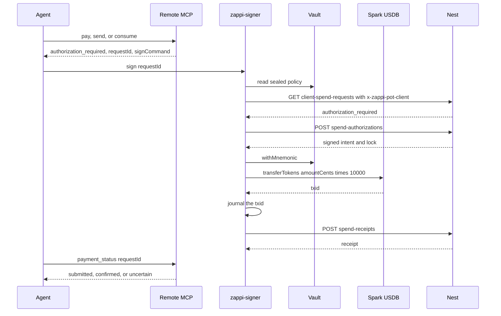

# Architecture

`zappi-signer` is a local command. A remote MCP call on a ready free pot returns `authorization_required` and a `requestId`. This process then pulls a backend-signed intent, opens the vault, moves USDB, and posts a receipt.

The mnemonic is sealed in the absorbed zappi-pots-mcp vault. Nest stores the Spark address and the spend row. It does not receive the mnemonic.

## Trust invariants

- The vault unlock secret is the keychain item `seed-vault-unlock` on service `zappi-signer`. The first create generates it. A recovery passphrase is used only by `backup` and `restore`, from `ZAPPI_SIGNER_RECOVERY` or a TTY prompt.
- Version 4 field keys mix the scrypt key with the 32-byte device factor (`zappi-pot-device-v4`). A file opened with a different factor fails with `vault is sealed to another device`. The on-disk `kind` remains `zappi-pots-mcp`.
- `ZAPPI_SIGNER_API_URL` must be `https`, or `http` on `127.0.0.1`, `localhost`, or `[::1]` for a local Nest. Any other `http` host, userinfo, a query, and a fragment are refused before a socket call.
- Install pins live in `ZAPPI_SIGNER_SERVER_PUBKEY` and `~/.zappi-signer/trust.json`. `GET /api/signer/trust` can confirm those pins. An advertised key that is not pinned is ignored. A pinned key that is missing or different refuses the spend.
- Spend requests send `x-zappi-pot-client` from keychain account `pot-client-token-<potId>`. The token is not placed in the URL. When the token is absent (a wallet-first MCP free pot has none), the signer signs `zappi-pot-signer:v1:<scope>:<potId>:<subject>:<stamp>` with the vault's Spark identity key and sends `x-zappi-pot-id`, `x-zappi-pot-signer-stamp`, and `x-zappi-pot-signer-signature` instead; the server verifies against the pubkey derived from the pot's bound address. Token auth is preferred whenever the token exists.
- A spend needs a verified intent and an open lock attestation. `decision: "locked"`, a bad signature, an unknown `keyId`, or an expiry outside the window refuses the spend. Nonces are single-use in `~/.zappi-signer/intent-nonces.json`.
- A missing sealed policy refuses the spend. A receiver or destination entry of `*` or `WILDCARD` refuses the spend. Policy caps are compared to `amountCents`.
- USDB leaves through `sendUsdbFromPot` in `src/spark/usdb.ts`. The amount is `amountCents × 10000` base units. The token must be the one canonical `btkn1` USDB identifier on `MAINNET` (ticker `USDB`, 6 decimals). `SparkSigner.transfer` sends sats and is not this path.
- `FileSpendJournal` at `~/.zappi-signer/spend-journal.json` records `intentId → { txid, receipted }`. A later `sign` that finds a txid posts that txid as `submitted` and does not broadcast again. A spent nonce with no journaled txid posts `uncertain` and does not invent a txid.
- `provision` writes the pot with `bound: false`. `prove-address` calls `markBound` only after `verifyBindingReceipt` succeeds.
- `policy tighten` may only narrow caps, destinations, and guards, and it requires keystore user presence. A keystore without `confirmUserPresence` fails closed.

## Module map

Pull-model signing, added around the absorbed store:

| Module | Role |
| --- | --- |
| `src/index.ts` | CLI argv and `sign` |
| `src/cli-dispatch.ts` | `status`, `policy`, `provision`, `prove-address`, `backup`, `restore` |
| `src/sign-flow.ts` | Confirm, verify, journal, broadcast, receipt |
| `src/client.ts` | HTTPS client, `x-zappi-pot-client` |
| `src/config.ts` | `ZAPPI_SIGNER_API_URL` |
| `src/trust.ts` | Install pins |
| `src/intent.ts` | Intent, lock, and binding-receipt verification |
| `src/intent-store.ts` | Nonce ledger |
| `src/spend-journal.ts` | `FileSpendJournal` |
| `src/commands/provision.ts` | Address challenge and `markBound` |
| `src/commands/policy.ts` | View and monotonic tighten |
| `src/commands/backup.ts` | Recovery envelope |
| `src/commands/status.ts` | Public spend lookup |

Absorbed zappi-pots-mcp store. The vault writer still emits `kind: "zappi-pots-mcp"` and `version: 4`:

| Module | Role |
| --- | --- |
| `src/vault/vault.ts` | Multi-pot file, scrypt, device-bound fields, `markBound` |
| `src/vault/lock.ts` | Vault file lock |
| `src/vault/user-backup.ts` | Argon2id backup envelope |
| `src/vault/cloud-token.ts` | Cloud token records sealed in the same file |
| `src/keystore/os.ts` | OS keystore (`@napi-rs/keyring` on Linux and Windows; macOS helper) |
| `src/keystore/types.ts` | Service `zappi-signer` and account names |
| `src/keystore/factor.ts` | Device factor |
| `src/kdf.ts` | scrypt for the vault; Argon2id for the user backup |
| `src/policy/policy.ts` | Sealed spending policy |
| `src/policy/enforce.ts` | Policy hook used while verifying an intent |
| `src/guards.ts` | Freeze and velocity |
| `src/master.ts` | Child mnemonic when a pot is derived from the vault master |
| `src/spark/usdb.ts` | USDB `transferTokens` |
| `src/spark/sdk.ts` | Spark SDK adapter, including sats `transfer` |
| `src/spark/signer.ts` | `SparkSigner` surface |
| `src/spark/address.ts` | Spark address checks |
| `src/paths.ts` | `~/.zappi-signer/seed-vault.json` |
| `src/fs-safe.ts`, `src/zeroize.ts` | No-follow reads and wiping |

`spend-journal.json`, `intent-nonces.json`, and `trust.json` sit in the same directory as the vault file. On Windows that directory is `%APPDATA%\zappi-signer\` ([platforms.md](platforms.md)).

## Sequence

1. The agent calls remote MCP `pay`, `send`, or `consume`. A ready free pot returns `status: "authorization_required"`, `requestId`, `approvalId`, `potId`, `amountCents`, `receiverSparkAddress`, `network: "MAINNET"`, and `signCommand`. An auth-required pot returns an approve URL and does not enter this sequence. The connector does not hold a seed.
2. `zappi-signer sign <requestId>` loads `ZAPPI_POT_ID`, the pot client token, and the install pin. It verifies `GET /api/signer/trust`, then `GET /api/wallet/pots/client-spend-requests/:requestId`.
3. The human confirms on a TTY, or the caller passes `--yes`. The CLI posts `POST /api/wallet/pots/:id/spend-authorizations` with `approvalId` and `idempotencyKey` set to the `requestId`.
4. The CLI verifies the intent and the lock against the pin, consumes the nonces, and runs the sealed policy. It opens the mnemonic with `withMnemonic`.
5. `sendUsdbFromPot` selects the canonical `btkn1` USDB token and calls `transferTokens`. The txid is written to the spend journal before the receipt is posted.
6. The CLI posts `POST /api/wallet/pots/:id/spend-receipts`. A broadcast that already has a journaled txid is posted as `submitted`. Confirmation observed on this call is posted as `confirmed`. An unknown outcome after the transfer starts, or a replay with no txid, is posted as `uncertain`.
7. The agent calls remote `payment_status` with the same `requestId` until `submitted`, `confirmed`, or `uncertain`.

A restart repeats step 6 from the journal. It does not call `transferTokens` again for an intent that already has a txid.
